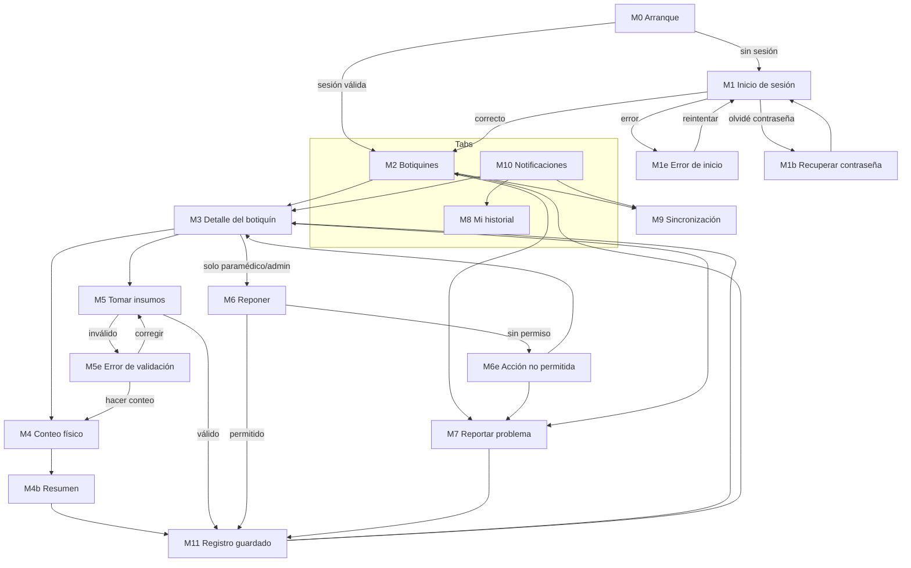
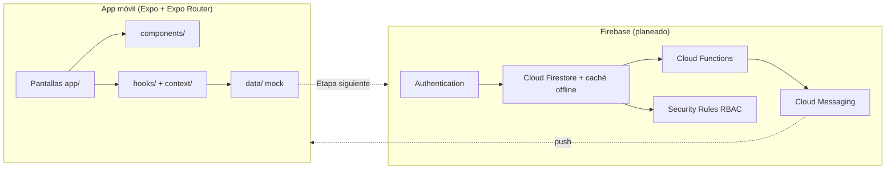

# PrimaKit — App móvil de botiquines

Sistema de administración y trazabilidad de botiquines para **Más Bosque Manu A.C.** (Bosque de La Primavera).
Proyecto de la materia *Integración de seguridad informática en redes y sistemas de software* · Grupo 501 · Equipo 31.

**Equipo:** Andrea Marlene Ramos Tiscareño · Evelyn Samantha Bravo Frausto · Francisco Manuel Alarcon Rodas · César Ramón Verdugo Medina

## Propósito de este repositorio

Este repositorio contiene el **esqueleto de la app móvil** (paramédicos y voluntarios) de la Etapa 3. Materializa el esquema de navegación diseñado en la Etapa 2: las 17 pantallas móviles (M0–M11 con sus pantallas de error) ya existen y están conectadas entre sí, con **datos de ejemplo** (sin almacenamiento ni backend todavía).

El panel web del administrador (W0e–W9b) está diseñado en la Etapa 2 pero **no forma parte de este repositorio**.

## Cómo correrlo

```bash
npm install
npx expo start      # escanea el QR con Expo Go, o presiona "a" / "i" / "w"
npx tsc --noEmit    # revisión de tipos
```

Para probar los roles, inicia sesión con cualquier correo válido y una contraseña de 6+ caracteres:

| Correo contiene | Rol | Efecto |
| --- | --- | --- |
| `voluntario` | Voluntario | Se oculta "Reponer" en el detalle del botiquín |
| `admin` | Administrador | Igual que paramédico en la app móvil |
| cualquier otro | Paramédico | Puede reponer |

Un correo sin `@` o una contraseña corta lleva a la pantalla de error M1e. En "Tomar insumos", dejar el folio FRAP vacío con motivo *Accidente*, o pedir más de lo disponible, lleva a M5e.

## Estructura del proyecto

```
app/                      Rutas (Expo Router): cada archivo es una pantalla
├── _layout.tsx           Raíz: SessionProvider + Stack
├── index.tsx             M0  Arranque
├── (auth)/               Grupo sin sesión
│   ├── login.tsx         M1  Inicio de sesión
│   ├── login-error.tsx   M1e Error de inicio
│   └── recover.tsx       M1b Recuperar contraseña
└── (main)/               Grupo protegido (redirige a /login sin sesión)
    ├── (tabs)/
    │   ├── kits.tsx          M2  Botiquines
    │   ├── notifications.tsx M10 Notificaciones
    │   ├── history.tsx       M8  Mi historial
    │   └── account.tsx       Cuenta / cerrar sesión
    ├── kit/[id]/
    │   ├── index.tsx         M3  Detalle del botiquín
    │   ├── count.tsx         M4  Conteo físico
    │   ├── count-summary.tsx M4b Resumen del conteo
    │   ├── take.tsx          M5  Tomar insumos
    │   ├── take-error.tsx    M5e Error de validación
    │   ├── restock.tsx       M6  Reponer
    │   └── not-allowed.tsx   M6e Acción no permitida
    ├── report.tsx            M7  Reportar problema
    ├── sync.tsx              M9  Sincronización
    └── saved.tsx             M11 Registro guardado
components/               Piezas de UI reutilizables (Button, KitCard, Notice, ...)
constants/                Tema (colores, estatus) y roles
context/                  SessionContext: sesión simulada y rol
data/                     Datos de ejemplo (kits, historial, notificaciones)
hooks/                    useKit: lee el parámetro :id y devuelve botiquín + insumos
types/                    Tipos TypeScript compartidos
```

## Diagramas

### Navegación



### Arquitectura



Hoy solo existe el recuadro de la app; los servicios de Firebase son el plan del diseño de la Etapa 2 y se conectarán en las siguientes etapas:

| Servicio | Uso |
| --- | --- |
| Firebase Authentication | Inicio de sesión, recuperación de contraseña, tokens |
| Cloud Firestore (caché local) | Botiquines, insumos, conteos, movimientos, alertas; lectura y escritura sin señal |
| Cloud Functions | Recalcular stock, generar alertas, invitar usuarios, asignar roles |
| Security Rules | Permisos por rol; registros de solo agregar |
| Firebase Cloud Messaging | Notificaciones push |
| Cloud Storage | Reportes CSV con URL firmada (panel web) |

## Decisiones de arquitectura

**Navegación: Expo Router (no React Navigation "a mano").**
- Las rutas son los archivos de `app/`; agregar una pantalla es crear un archivo, y la estructura de carpetas *es* el mapa de navegación de la Etapa 2.
- Los grupos `(auth)` y `(main)` separan el flujo sin sesión del protegido, y el guard de sesión vive en un solo lugar (`app/(main)/_layout.tsx`).
- Es la opción recomendada por Expo y está construida sobre React Navigation, así que no se pierde nada: se sigue usando Stack y Tabs.

**Stack para el flujo, Tabs para el inicio.** Las secciones de uso frecuente (Botiquines, Notificaciones, Historial, Cuenta) son pestañas. El resto (detalle, conteo, uso, reposición, errores) son pantallas apiladas porque son flujos con un principio y un fin.

**Pantallas de error como rutas propias.** M1e, M5e y M6e son pantallas independientes, como en el diseño de la Etapa 2, para poder revisarlas y probarlas por separado.

**Offline-first.** Los usuarios están en el bosque sin señal. Por eso M11 confirma que el registro se guardó en el teléfono y M9 muestra la cola pendiente. Firestore con caché local resolverá esto sin código propio de sincronización.

**Seguridad por rol en servidor, no solo en la interfaz.** La app oculta "Reponer" a voluntarios, pero la regla real vivirá en las Security Rules; por eso existe M6e para cuando el servidor rechaza la acción.

**TypeScript estricto y alias `@/`** para importar sin rutas relativas largas (`@/components/Button`).

**Sesión simulada.** `SessionContext` finge la autenticación para poder recorrer todos los flujos; se reemplazará por Firebase Auth manteniendo la misma interfaz (`session`, `signIn`, `signOut`).

## Estado actual

- [x] Navegación completa entre las pantallas móviles del diseño
- [x] Guard de sesión y ocultar "Reponer" por rol
- [x] Validaciones locales de "Tomar insumos"
- [ ] Autenticación real (Firebase Auth)
- [ ] Persistencia y sincronización (Firestore)
- [ ] Notificaciones push (FCM)
- [ ] Panel web de administración
