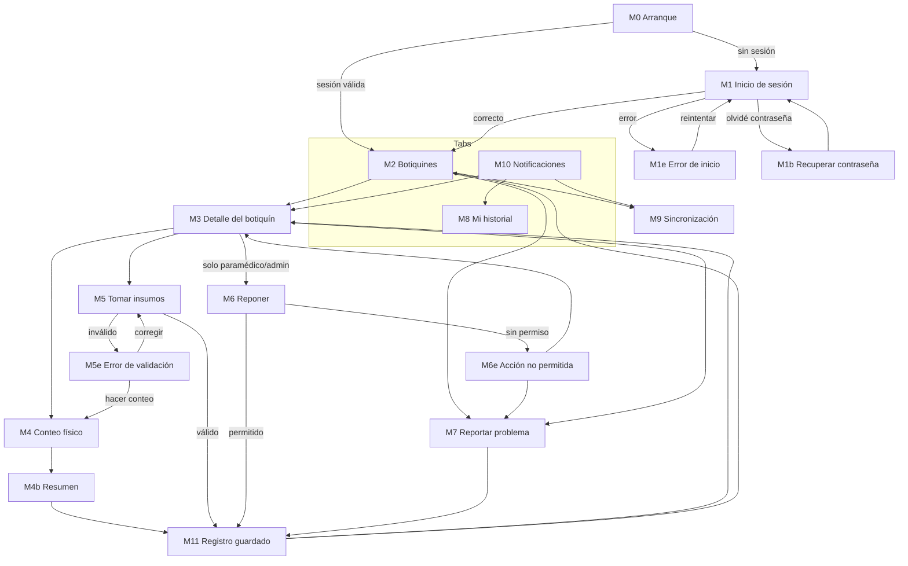
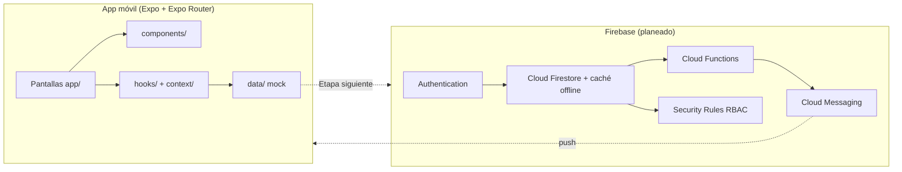

# PrimaKit — App móvil de botiquines

Sistema de administración y trazabilidad de botiquines para **Más Bosque Manu A.C.** (Bosque de La Primavera).
Proyecto de la materia *Integración de seguridad informática en redes y sistemas de software* · Grupo 501 · Equipo 31.

**Equipo:** Andrea Marlene Ramos Tiscareño · Evelyn Samantha Bravo Frausto · Francisco Manuel Alarcon Rodas · César Ramón Verdugo Medina

## Propósito de este repositorio

Este repositorio contiene el **esqueleto de la app móvil** (paramédicos y voluntarios) de la Etapa 3. Materializa el esquema de navegación diseñado en la Etapa 2: las 17 pantallas móviles (M0–M11 con sus pantallas de error) ya existen y están conectadas entre sí, con **datos de ejemplo** (sin almacenamiento ni backend todavía).

El panel web del administrador (W0e–W9b) está diseñado en la Etapa 2 pero **no forma parte de este repositorio**.

## Cómo correrlo

El proyecto usa **Expo SDK 58** (React Native 0.88, React 19.3).

```bash
npm install
npm start           # escanea el QR con Expo Go, o presiona "a" / "i" / "w"
```

Usa `npm start` en lugar de `npx expo start`: el script ya define `EXPO_ROUTER_DISABLE_RN_NAVIGATION_CHECK=1`. Las variables de entorno esperadas están listadas, sin valores, en `.env.example`.

### Scripts

| Comando | Qué hace |
| --- | --- |
| `npm start` | Inicia Metro (servidor de desarrollo de Expo) |
| `npm run lint` | Revisión de estilo con ESLint (`eslint-config-expo`) |
| `npm run typecheck` | Revisión de tipos con TypeScript (`tsc --noEmit`) |
| `npm test` | Pruebas unitarias con Jest (`jest-expo`) |
| `npm run test:watch` | Jest en modo observador: vuelve a correr al guardar |
| `npm run test:coverage` | Jest con reporte de cobertura (carpeta `coverage/`, ignorada por Git) |
| `npm run test:rules` | Pruebas de las Security Rules de Firestore contra el emulador de Firebase |
| `npm run e2e` | Flujos E2E de Maestro en un emulador de Android |

### Cuentas de prueba

Todavía no hay cuentas reales: el inicio de sesión está **simulado** (se reemplazará por Firebase Auth). Sirve cualquier correo que tenga `@` junto con una contraseña de **6 o más caracteres**. El rol se decide por una palabra dentro del correo:

| Correo de ejemplo | Contraseña de ejemplo | Rol | Efecto |
| --- | --- | --- | --- |
| `voluntario@correo.com` | `123456` | Voluntario | Se oculta el botón "Reponer" en el detalle del botiquín |
| `paramedico@correo.com` | `123456` | Paramédico | Puede reponer insumos |
| `admin@correo.com` | `123456` | Administrador | Igual que paramédico en la app móvil |
| `maria@correo.com` | `123456` | Paramédico | Cualquier otro correo se trata como paramédico |

Para ver la pantalla de error de inicio de sesión (M1e), prueba con datos inválidos:

| Correo | Contraseña | Resultado |
| --- | --- | --- |
| `paramedico` (sin `@`) | `123456` | Error M1e |
| `paramedico@correo.com` | `123` (menos de 6) | Error M1e |

La pantalla "Acción no permitida" (M6e) existe, pero hoy no se puede alcanzar desde la interfaz: a los voluntarios se les oculta "Reponer", y el rechazo del servidor solo ocurrirá cuando se conecten las Security Rules de Firebase. En "Tomar insumos", dejar el folio FRAP vacío con motivo *Accidente*, o pedir más de lo disponible, lleva a M5e.

## Pruebas

Hay tres niveles de prueba. Cada uno revisa algo distinto:

| Nivel | Herramienta | Qué revisa | Dónde viven |
| --- | --- | --- | --- |
| Unitarias | Jest + `jest-expo` | Funciones sueltas del código | `__tests__/` |
| Reglas de seguridad | `@firebase/rules-unit-testing` + emulador de Firestore | Que las Security Rules rechacen lo que deben rechazar | `rules-tests/` |
| E2E (punta a punta) | Maestro | La app completa, como la usa una persona | `.maestro/` |

### Unitarias (`npm test`)

No requieren nada extra. Hoy solo existe una prueba de ejemplo (`__tests__/sumar.tests.ts` sobre `utils/sumar.ts`) que valida que Jest está bien configurado. La configuración está en la sección `"jest"` de `package.json` e ignora `rules-tests/`.

### Reglas de Firestore (`npm run test:rules`)

Requisitos en la computadora: **Java** (lo usa el emulador de Firestore) y **Firebase CLI** (`firebase-tools`, instalado de forma global).

- `firebase.json` configura los emuladores de Auth (puerto 9099) y Firestore (puerto 8080), más la interfaz del emulador.
- `firestore.rules` hoy **niega todo** (`allow read, write: if false`). Es el punto de partida "denegar por defecto"; los permisos por rol se agregarán en fases posteriores.
- `rules-tests/deny-all.test.ts` comprueba que, sin sesión, no se puede leer ni escribir un botiquín.
- El script usa `firebase emulators:exec` con el proyecto `demo-primakit`: prende el emulador, corre las pruebas (configuradas en `jest.rules.config.js`) y lo apaga. Los proyectos `demo-` nunca se conectan a la nube.

Todavía **no existe un proyecto real de Firebase** conectado a la app.

### E2E con Maestro (`npm run e2e`)

Requisitos: **Maestro CLI**, **adb** (Android SDK platform-tools) y un emulador de Android (AVD). La app se abre dentro de **Expo Go**.

Orden para correrlo:

1. Prender el emulador y esperar a que `adb shell getprop sys.boot_completed` responda `1`.
2. `npm start` (dejar esa terminal abierta).
3. En otra terminal: `npm run e2e`.

`scripts/e2e.js` detecta la IP de la red local con `lan-network` (el mismo paquete que usa Expo CLI) y se la pasa a Maestro como la variable `APP_URL`, así que no hay que editar los flujos al cambiar de red Wi-Fi. Luego corre todos los flujos de `.maestro/`.

Flujo actual: `.maestro/abrir-app.yaml` abre la app y comprueba que se vean "Bienvenido" e "Iniciar sesión".

> **Nota:** en el emulador que se usó (Android API 37), las direcciones `exp://10.0.2.2:8081` y `exp://127.0.0.1:8081` **no funcionaron** desde Expo Go; solo la IP de la red local. Por eso el script usa esa IP.

## Seguridad del repositorio

- **`.env.example`**: lista las variables de entorno sin valores. El `.env` real no se sube (está en `.gitignore`). Las variables `EXPO_PUBLIC_` quedan dentro de la app, así que nunca deben contener secretos.
- **GitHub:** están activos secret scanning con **push protection**, **Dependabot alerts**, **Dependabot security updates** y **CodeQL** (configuración por defecto).
- **Gitleaks:** se corrió `gitleaks git -v` sobre el historial y no encontró fugas.
- **`.github/dependabot.yml`**: revisa dependencias de npm cada semana, con un máximo de 5 PRs abiertos. Agrupa los paquetes de Expo e ignora saltos mayores de `expo`/`expo-*` y saltos mayores o menores de `react`, `react-dom` y `react-native`, porque esas versiones las fija el SDK de Expo (se actualizan con `npx expo install`).

## Estructura del proyecto

```
app/                      Rutas (Expo Router): cada archivo es una pantalla
├── _layout.tsx           Raíz: SessionProvider + Stack
├── index.tsx             M0  Arranque
├── (auth)/               Grupo sin sesión
│   ├── login.tsx         M1  Inicio de sesión
│   ├── login-error.tsx   M1e Error de inicio
│   └── recover.tsx       M1b Recuperar contraseña
└── (main)/               Grupo protegido (redirige a /login sin sesión)
    ├── (tabs)/
    │   ├── kits.tsx          M2  Botiquines
    │   ├── notifications.tsx M10 Notificaciones
    │   ├── history.tsx       M8  Mi historial
    │   └── account.tsx       Cuenta / cerrar sesión
    ├── kit/[id]/
    │   ├── index.tsx         M3  Detalle del botiquín
    │   ├── count.tsx         M4  Conteo físico
    │   ├── count-summary.tsx M4b Resumen del conteo
    │   ├── take.tsx          M5  Tomar insumos
    │   ├── take-error.tsx    M5e Error de validación
    │   ├── restock.tsx       M6  Reponer
    │   └── not-allowed.tsx   M6e Acción no permitida
    ├── report.tsx            M7  Reportar problema
    ├── sync.tsx              M9  Sincronización
    └── saved.tsx             M11 Registro guardado
components/               Piezas de UI reutilizables (Button, KitCard, Notice, ...)
constants/                Tema (colores, estatus) y roles
context/                  SessionContext: sesión simulada y rol
data/                     Datos de ejemplo (kits, historial, notificaciones)
hooks/                    useKit: lee el parámetro :id y devuelve botiquín + insumos
types/                    Tipos TypeScript compartidos
utils/                    Funciones de lógica (hoy solo el ejemplo sumar.ts)
__tests__/                Pruebas unitarias de Jest
rules-tests/              Pruebas de Security Rules (corren contra el emulador)
.maestro/                 Flujos E2E de Maestro
scripts/                  e2e.js: corre Maestro con la IP local detectada
.github/dependabot.yml    Configuración de Dependabot
firebase.json             Configuración de los emuladores de Firebase
firestore.rules           Security Rules de Firestore (hoy: denegar todo)
jest.rules.config.js      Configuración de Jest para rules-tests/
.env.example              Variables de entorno esperadas, sin valores
```

## Diagramas

### Navegación



### Arquitectura



Hoy solo existe el recuadro de la app; los servicios de Firebase son el plan del diseño de la Etapa 2 y se conectarán en las siguientes etapas:

| Servicio | Uso |
| --- | --- |
| Firebase Authentication | Inicio de sesión, recuperación de contraseña, tokens |
| Cloud Firestore (caché local) | Botiquines, insumos, conteos, movimientos, alertas; lectura y escritura sin señal |
| Cloud Functions | Recalcular stock, generar alertas, invitar usuarios, asignar roles |
| Security Rules | Permisos por rol; registros de solo agregar |
| Firebase Cloud Messaging | Notificaciones push |
| Cloud Storage | Reportes CSV con URL firmada (panel web) |

## Decisiones de arquitectura

**Navegación: Expo Router (no React Navigation "a mano").**
- Las rutas son los archivos de `app/`; agregar una pantalla es crear un archivo, y la estructura de carpetas *es* el mapa de navegación de la Etapa 2.
- Los grupos `(auth)` y `(main)` separan el flujo sin sesión del protegido, y el guard de sesión vive en un solo lugar (`app/(main)/_layout.tsx`).
- Es la opción recomendada por Expo y está construida sobre React Navigation, así que no se pierde nada: se sigue usando Stack y Tabs.

**Stack para el flujo, Tabs para el inicio.** Las secciones de uso frecuente (Botiquines, Notificaciones, Historial, Cuenta) son pestañas. El resto (detalle, conteo, uso, reposición, errores) son pantallas apiladas porque son flujos con un principio y un fin.

**Pantallas de error como rutas propias.** M1e, M5e y M6e son pantallas independientes, como en el diseño de la Etapa 2, para poder revisarlas y probarlas por separado.

**Offline-first.** Los usuarios están en el bosque sin señal. Por eso M11 confirma que el registro se guardó en el teléfono y M9 muestra la cola pendiente. Firestore con caché local resolverá esto sin código propio de sincronización.

**Seguridad por rol en servidor, no solo en la interfaz.** La app oculta "Reponer" a voluntarios, pero la regla real vivirá en las Security Rules; por eso existe M6e para cuando el servidor rechaza la acción.

**TypeScript estricto y alias `@/`** para importar sin rutas relativas largas (`@/components/Button`).

**Sesión simulada.** `SessionContext` finge la autenticación para poder recorrer todos los flujos; se reemplazará por Firebase Auth manteniendo la misma interfaz (`session`, `signIn`, `signOut`).

## Estado actual

- [x] Navegación completa entre las pantallas móviles del diseño
- [x] Guard de sesión y ocultar "Reponer" por rol
- [x] Validaciones locales de "Tomar insumos"
- [x] Actualización a Expo SDK 58
- [x] Protección de secretos y dependencias (`.env.example`, push protection, Gitleaks, Dependabot, CodeQL)
- [x] Jest configurado con una prueba de ejemplo
- [x] Emulador de Firebase con reglas "denegar todo" y sus pruebas
- [x] Primer flujo E2E con Maestro
- [ ] Pruebas de la lógica real (validaciones de uso, reposición, conteo y registros)
- [ ] Integración continua (GitHub Actions)
- [ ] Autenticación real (Firebase Auth)
- [ ] Persistencia y sincronización (Firestore)
- [ ] Notificaciones push (FCM)
- [ ] Panel web de administración
